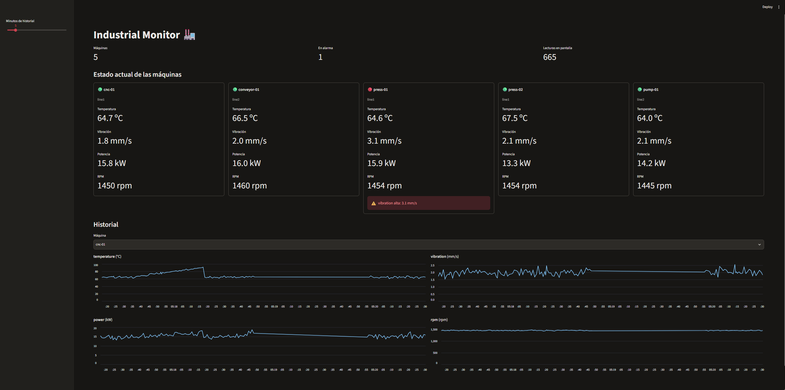

# Industrial Monitor — detección de anomalías en planta

Sistema de monitorización industrial en Python: una planta simulada envía lecturas de sensores por **MQTT**, un colector las guarda en una base de datos y un modelo de **machine learning** detecta comportamientos anómalos que pueden anticipar una avería (mantenimiento predictivo).



> 🚧 Proyecto en desarrollo. Ver [hoja de ruta](#hoja-de-ruta).

## Arquitectura

```
 ┌─────────────┐   MQTT    ┌───────────┐   MQTT    ┌─────────────┐        ┌──────────┐
 │  Simulador  │ ────────► │ Mosquitto │ ────────► │  Colector   │ ─────► │  SQLite  │
 │ (5 máquinas)│ telemetry │  (broker) │           │             │        │          │
 └─────────────┘           └───────────┘           └─────────────┘        └────┬─────┘
                                                                                │
                                              ┌──────────────┐                 │
                                              │  Dashboard   │ ◄───────────────┤
                                              │ (Streamlit)  │                 │
                                              └──────────────┘    ┌────────────┴─────┐
                                                                  │ Detector anomalías│
                                                                  │  (scikit-learn)   │   
                                                                  └──────────────────┘
```

**Topics MQTT:** `factory/<línea>/<máquina>/telemetry`

**Cada lectura** (JSON):

```json
{
  "machine_id": "press-01",
  "line": "line1",
  "timestamp": "2026-11-17T16:30:00+00:00",
  "temperature": 65.3,
  "vibration": 2.01,
  "power": 15.2,
  "rpm": 1448.7,
  "fault": null
}
```

## Simulación de averías

Cada máquina funciona alrededor de unos valores normales con ruido. Con una probabilidad baja empieza a desarrollar una avería, que hace que algunos sensores se desvíen poco a poco hasta que la máquina se "repara":

| Avería | Efecto |
|---|---|
| `overheating` | Sube la temperatura y algo el consumo |
| `bearing_wear` | Sube la vibración, algo la temperatura y bajan las RPM |
| `overload` | Sube el consumo y la temperatura, bajan las RPM |

El campo `fault` es la etiqueta real (ground truth). El detector **no** la usa para decidir: sirve para medir cuántas averías detecta y con cuánta antelación.

## Cómo ejecutarlo

### Con Docker (recomendado)

```bash
docker compose up --build
```

Levanta el broker, el simulador y el colector. Los datos se guardan en `data/readings.db`.

### En local

Necesitas un broker MQTT (por ejemplo [Mosquitto](https://mosquitto.org/download/)) escuchando en `localhost:1883`.

```bash
python -m venv .venv
source .venv/bin/activate        # Windows: .venv\Scripts\activate
pip install -r requirements-dev.txt

python -m monitor.collector      # terminal 1
python -m monitor.simulator      # terminal 2
```

### Tests

```bash
pytest
```

## Configuración

Variables de entorno (todas opcionales):

| Variable | Por defecto | Descripción |
|---|---|---|
| `MQTT_HOST` | `localhost` | Host del broker |
| `MQTT_PORT` | `1883` | Puerto del broker |
| `DB_PATH` | `data/readings.db` | Ruta de la base de datos |
| `INTERVAL` | `1.0` | Segundos entre lecturas |
| `FAULT_PROBABILITY` | `0.01` | Probabilidad por lectura de que empiece una avería |

## Hoja de ruta

- [x] Simulador de sensores con averías progresivas
- [x] Envío de telemetría por MQTT
- [x] Colector y almacenamiento en SQLite
- [x] Docker Compose
- [x] Dashboard en Streamlit con estado de las máquinas
- [ ] Detector de anomalías (Isolation Forest)
- [ ] Modelo de predicción de fallos entrenado con el dataset AI4I 2020
- [ ] Alertas en el dashboard

## Tecnologías

Python · paho-mqtt · Mosquitto · SQLite · Docker · Streamlit · pandas
